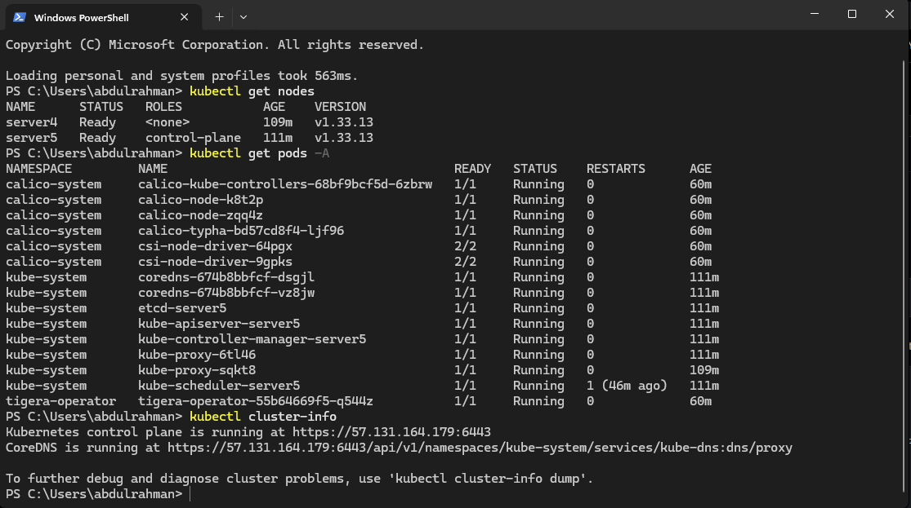
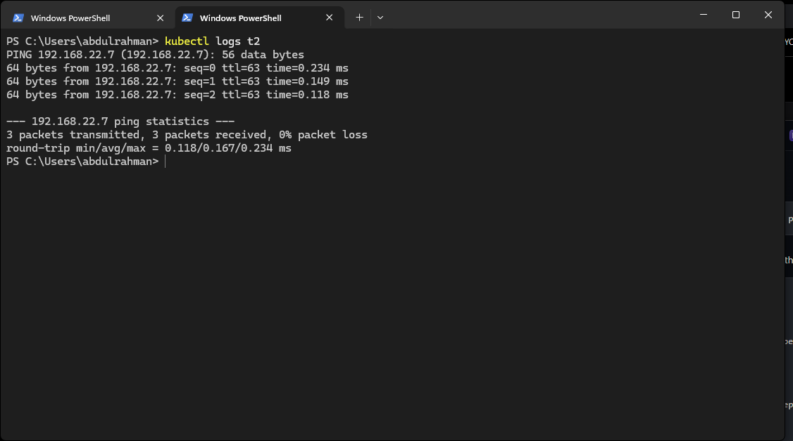

# Lab 9 — Kubernetes Cluster with Kubeadm

Two-node cluster built with kubeadm:

| Node | Role |
|---|---|
| control-plane | Ubuntu 24.04, 4 GB RAM |
| worker | Ubuntu 24.04, 4 GB RAM |

Stack: containerd 2.2.1, Kubernetes v1.33.13, Calico v3.33.0.

## 1. Container runtime (both nodes)

```bash
sudo apt install -y containerd
containerd config default | sudo tee /etc/containerd/config.toml
# then set:  SystemdCgroup = true
sudo systemctl restart containerd && sudo systemctl enable containerd
```

If a node already runs Docker with live containers, don't touch its containerd — give Kubernetes an **isolated instance** instead: same binary, own config/socket/root.

```
/etc/containerd-k8s/config.toml
  root  = "/var/lib/containerd-k8s"
  state = "/run/containerd-k8s"
  [grpc] address = "/run/containerd-k8s/containerd.sock"
  [plugins."io.containerd.grpc.v1.cri"]
    sandbox_image = "registry.k8s.io/pause:3.10"
    ...runtimes.runc.options  SystemdCgroup = true

/etc/systemd/system/containerd-k8s.service
  ExecStart=/usr/bin/containerd -c /etc/containerd-k8s/config.toml
```

Then point kubelet at it via `/etc/default/kubelet`:

```
KUBELET_EXTRA_ARGS=--container-runtime-endpoint=unix:///run/containerd-k8s/containerd.sock
```

and pass `--cri-socket unix:///run/containerd-k8s/containerd.sock` to `kubeadm join`. Existing Docker workloads are never restarted.

## 2. kubeadm, kubelet, kubectl (both nodes)

```bash
cat <<EOF | sudo tee /etc/modules-load.d/k8s.conf
overlay
br_netfilter
EOF
sudo modprobe overlay br_netfilter

cat <<EOF | sudo tee /etc/sysctl.d/k8s.conf
net.ipv4.ip_forward = 1
net.bridge.bridge-nf-call-iptables  = 1
net.bridge.bridge-nf-call-ip6tables = 1
EOF
sudo sysctl --system

curl -fsSL https://pkgs.k8s.io/core:/stable:/v1.33/deb/Release.key | sudo gpg --dearmor --yes -o /etc/apt/keyrings/kubernetes-apt-keyring.gpg
echo "deb [signed-by=/etc/apt/keyrings/kubernetes-apt-keyring.gpg] https://pkgs.k8s.io/core:/stable:/v1.33/deb/ /" | sudo tee /etc/apt/sources.list.d/kubernetes.list
sudo apt-get update && sudo apt-get install -y kubelet kubeadm kubectl
sudo apt-mark hold kubelet kubeadm kubectl
```

Swap must be off (`sudo swapoff -a`) or kubeadm preflight fails.

## 3. Init the control plane + join the worker

```bash
# control plane
sudo kubeadm init --pod-network-cidr=192.168.0.0/16

# configure kubectl for the regular user
mkdir -p ~/.kube && sudo cp /etc/kubernetes/admin.conf ~/.kube/config && sudo chown $(id -u):$(id -g) ~/.kube/config

# worker (command is printed by kubeadm init)
sudo kubeadm join <control-plane-ip>:6443 --token <token> --discovery-token-ca-cert-hash sha256:<hash>
```

## 4. Calico CNI

```bash
kubectl create -f https://raw.githubusercontent.com/projectcalico/calico/v3.33.0/manifests/tigera-operator.yaml
kubectl apply -f installation.yaml
```

`installation.yaml` — pin node-IP detection to the real NIC and pick the pod CIDR:

```yaml
apiVersion: operator.tigera.io/v1
kind: Installation
metadata:
  name: default
spec:
  calicoNetwork:
    nodeAddressAutodetectionV4:
      interface: ens3        # the interface holding the node's real IP
    ipPools:
    - name: default-ipv4-ippool
      blockSize: 26
      cidr: 192.168.0.0/16
      encapsulation: VXLANCrossSubnet
      natOutgoing: Enabled
      nodeSelector: all()
```

## 5. Verify

```
$ kubectl get nodes
$ kubectl get pods -A
$ kubectl cluster-info
```



Cross-node pod networking — a pod on the worker pinging a pod on the control plane:

```
3 packets transmitted, 3 packets received, 0% packet loss
```


